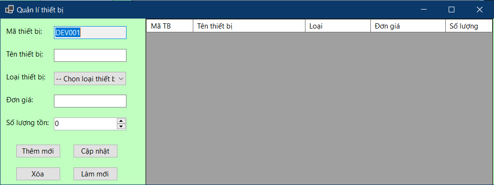
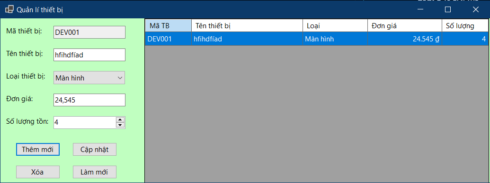
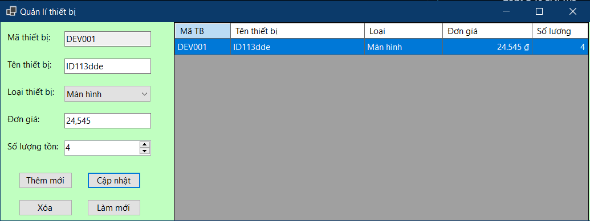
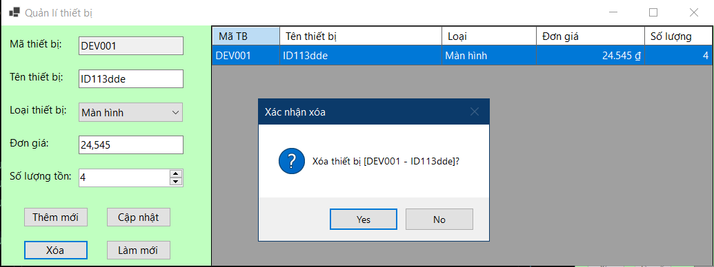
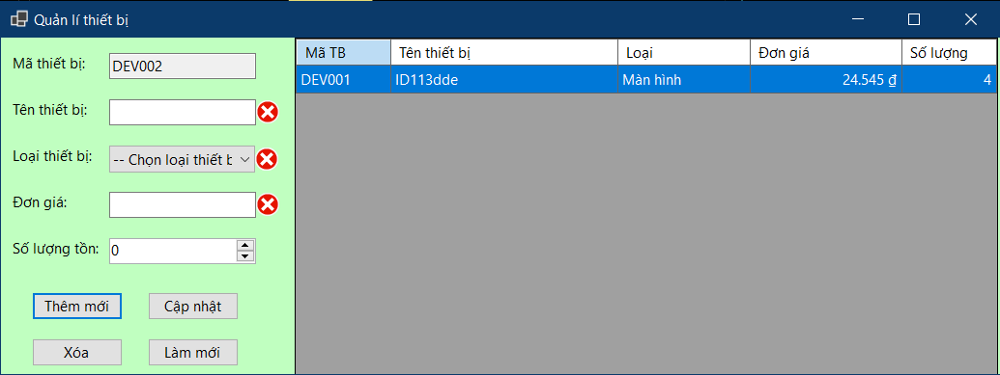

# Thông tin sinh viên
- **Họ và tên:** Phạm Văn Minh
- **Mã số sinh viên:** 24810310262
- **Lớp:** D19CNPM3
- **Tên môn học:** Lập trình C# / Windows Forms
- **Tên bài tập:** Bài kiểm tra số 02 - BÀI 1: XÂY DỰNG ỨNG DỤNG QUẢN LÝ DANH MỤC THIẾT BỊ ĐIỆN
TỬ (CƠ BẢN & DATA BINDING)
## KẾT QUẢ THỰC HÀNH

