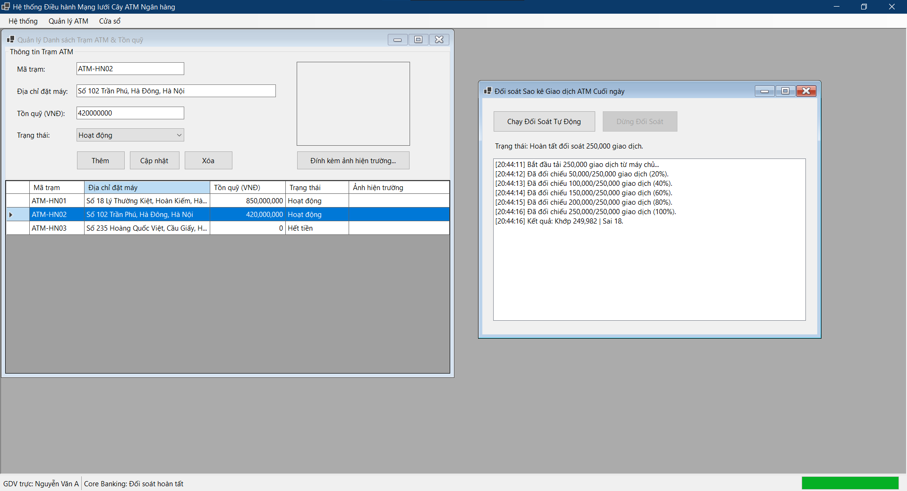

# Thông tin sinh viên
- **Họ và tên:** Phạm Văn Minh
- **Mã số sinh viên:** 24810310262
- **Lớp:** D19CNPM3
- **Tên môn học:** Lập trình C# / Windows Forms
- **Tên bài tập:** HỆ THỐNG MDI ĐIỀU HÀNH MẠNG LƯỚI CÂY ATM NGÂN HÀNG (KIẾN TRÚC MDI & ASYNC/AWAIT)
## KẾT QUẢ THỰC HÀNH
