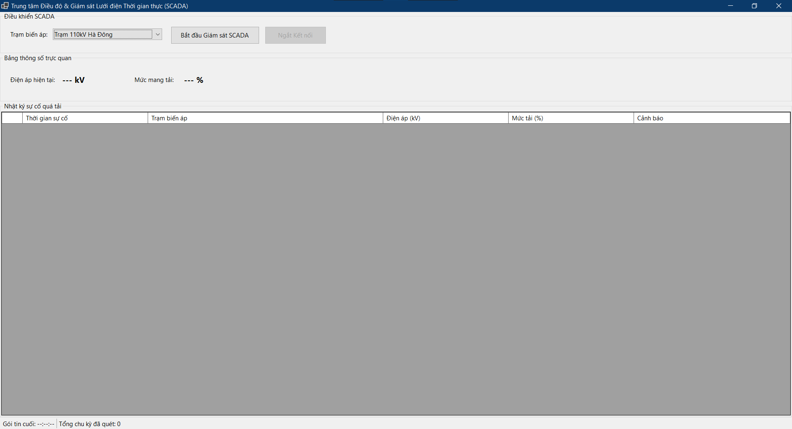
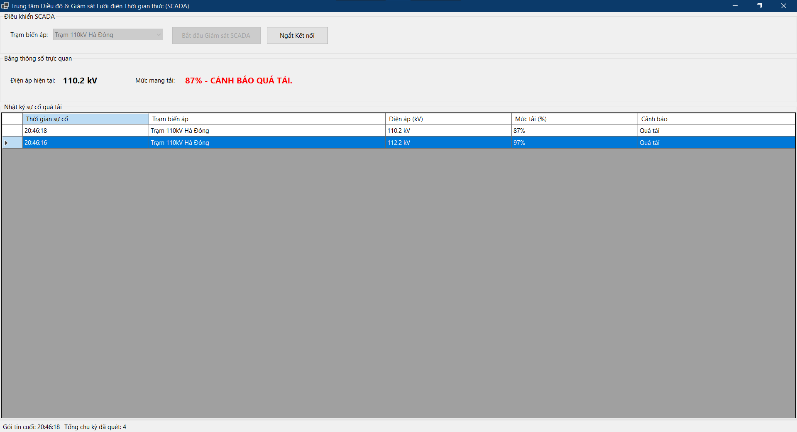

# Thông tin sinh viên
- **Họ và tên:** Phạm Văn Minh
- **Mã số sinh viên:** 24810310262
- **Lớp:** D19CNPM3
- **Tên môn học:** Lập trình C# / Windows Forms
- **Tên bài tập:** TRUNG TÂM ĐIỀU ĐỘ & GIÁM SÁT LƯỚI ĐIỆN THỜI GIAN THỰC (CROSS-THREAD SAFETY)
## KẾT QUẢ THỰC HÀNH

